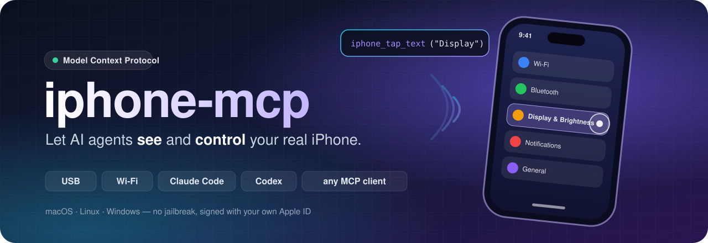
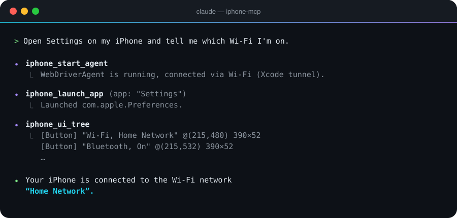
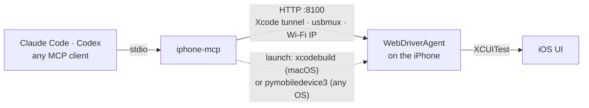

<!-- mcp-name: io.github.DamienDrash/iphone-mcp -->
<div align="center">



<br>

[](https://github.com/DamienDrash/iphone-mcp/actions/workflows/ci.yml)
[](https://pypi.org/project/iphone-mcp/)
[](https://pypi.org/project/iphone-mcp/)
[](https://modelcontextprotocol.io)
[](#-linux--windows)
[](LICENSE)
[](https://github.com/sponsors/DamienDrash)

**An [MCP](https://modelcontextprotocol.io) server that gives Claude Code, OpenAI Codex and any other MCP client<br>eyes and hands on a real, physical iPhone – over a cable or Wi-Fi.**

[Quick start](#-quick-start) · [Tools](#-tools) · [Wi-Fi](#-wi-fi) · [Linux & Windows](#-linux--windows) · [Reliability](#-reliability) · [Safety](#-safety) · [Troubleshooting](#-troubleshooting) · [Sponsor ❤](#-support-the-project)

</div>

---

<div align="center">

</div>

## ✨ Highlights

<table>
<tr>
<td width="50%" valign="top">

### 👀 Sees the screen
Screenshots come **scaled to iOS points**, so every pixel the model sees is a coordinate it can tap. The **UI tree** turns the screen into compact text with labels and positions. It is faster, cheaper and more precise than pixels.

</td>
<td width="50%" valign="top">

### 👆 Acts like a person
Tap, double-tap, long-press, **tap by text**, swipe, scroll, **pinch-zoom**, type, press Home and the volume buttons, and **wait for text** to appear instead of guessing delays. It can also launch apps by name (`"Settings"`, `"Einstellungen"`) and open URLs and deep links.

</td>
</tr>
<tr>
<td valign="top">

### 📶 Cable or Wi-Fi
It picks the best route on its own: the Xcode tunnel, then usbmux, then the iPhone's last known Wi-Fi IP. If the cable drops out, it **reconnects over Wi-Fi**.

</td>
<td valign="top">

### 🔆 Stays awake
While an agent is connected, the screen **doesn't auto-lock**. It sends an invisible touch just outside the display, and no settings are changed. This works even in Low Power Mode, where Auto-Lock is fixed at 30 s.

</td>
</tr>
<tr>
<td valign="top">

### 🔐 Your device, your signature
No jailbreak, no third-party cloud. WebDriverAgent is built and signed with **your own Apple ID** (a free one works), and all traffic stays between your computer and your phone.

</td>
<td valign="top">

### 🐧 Not only macOS
On Linux and Windows, WebDriverAgent starts **without Xcode** through pymobiledevice3's **root-free** tunnel. `iphone-mcp doctor` checks the whole chain.

</td>
</tr>
</table>

## 🚀 Quick start

**You need:** [uv](https://docs.astral.sh/uv/), an iPhone with an Apple ID, and a Mac with Xcode (for Linux / Windows see [below](#-linux--windows)).

**1 · Prepare the iPhone (once)**

- Connect it by cable, unlock it and tap **Trust**.
- Settings → Privacy & Security → **Developer Mode** → on (the phone restarts).
- Settings → Developer → **Enable UI Automation** → on.

**2 · Build WebDriverAgent (once, and again after Xcode updates)**

```bash
uvx iphone-mcp doctor     # checks Xcode, signing, iPhone
uvx iphone-mcp setup      # builds & installs WebDriverAgent, signed with your Apple ID
```

**3 · Add it to your agent**

<details open>
<summary><b>Claude Code</b></summary>

```bash
claude mcp add iphone -s user -- uvx iphone-mcp
```
</details>

<details>
<summary><b>OpenAI Codex</b></summary>

`~/.codex/config.toml`
```toml
[mcp_servers.iphone]
command = "uvx"
args = ["iphone-mcp"]
tool_timeout_sec = 180   # starting the agent can take a minute
```
</details>

<details>
<summary><b>Claude Desktop, Cursor, VS Code & other MCP clients</b></summary>

```json
{
  "mcpServers": {
    "iphone": { "command": "uvx", "args": ["iphone-mcp"] }
  }
}
```
</details>

<details>
<summary><b>From a git checkout</b></summary>

```bash
git clone https://github.com/DamienDrash/iphone-mcp.git && cd iphone-mcp
uv run iphone-mcp setup
claude mcp add iphone -s user -- uv --directory "$PWD" run iphone-mcp
```
</details>

**4 · Ask**, for example:

> *“Start the iPhone agent, open Settings and tell me which Wi-Fi I'm on.”*
>
> *“Open the App Store, search for ‘Duolingo’ and show me the rating – don't install anything.”*
>
> *“Test the sign-up flow of my TestFlight build and screenshot every step.”*

## 🧠 How it works



[WebDriverAgent](https://github.com/appium/WebDriverAgent) is the XCUITest-based agent that Appium also uses. It runs as a test runner on the iPhone and exposes the UI over HTTP. iphone-mcp:

- builds or installs it,
- starts it with `xcodebuild` or with pymobiledevice3's XCUITest service,
- keeps one connection alive across cable and Wi-Fi,
- turns it all into a handful of tools a model can use well.

## 🧰 Tools

| Tool | What it does |
|---|---|
| `iphone_start_agent` · `iphone_stop_agent` | Start / stop WebDriverAgent (cable or Wi-Fi) |
| `iphone_status` | Connection, screen size, lock state, keep-awake, foreground app |
| `iphone_screenshot` | Screenshot scaled to iOS points – image pixels = tap coordinates |
| `iphone_ui_tree` | Visible elements with text and center point |
| `iphone_wait_for` | Wait until a text appears (or disappears) – no guessing of delays |
| `iphone_tap` | Tap, double-tap or long-press at coordinates |
| `iphone_tap_text` | Tap the element showing a given text |
| `iphone_swipe` · `iphone_scroll` | Swipe / scroll in any direction |
| `iphone_pinch` | Two-finger pinch to zoom in or out |
| `iphone_type` | Type into the focused field, optionally press Return |
| `iphone_press_button` | Home, volume up, volume down |
| `iphone_lock` | Lock, or wake/unlock (without passcode) |
| `iphone_keep_awake` | Turn the no-auto-lock behaviour on or off |
| `iphone_list_apps` · `iphone_launch_app` · `iphone_close_app` | List, launch (name or bundle ID), terminate apps |
| `iphone_open_url` | Open a URL or deep link |

## 📶 Wi-Fi

1. Connect the iPhone by cable once. In Xcode open **Window → Devices and Simulators**, select the iPhone and tick **Connect via network**.
2. Put the iPhone and your Mac on the **same Wi-Fi**. The iPhone must be on Wi-Fi, not only on mobile data.
3. Unplug. `uvx iphone-mcp doctor` should now say `connected via Wi-Fi`.

iphone-mcp uses the tunnel that Xcode itself keeps to the phone. That tunnel works the same over cable and Wi-Fi, so a flaky cable is not a problem once Wi-Fi is set up.

## 🔆 Screen lock

| Situation | What happens |
|---|---|
| Agent connected | **Keep-awake** stops the screen from auto-locking. Turn it off with `iphone_keep_awake(false)` or `IPHONE_MCP_KEEP_AWAKE=0`. |
| Phone already locked | The tools say so. The agent can wake the screen; **you** enter the passcode or use Face ID – the agent can't, by design. |
| Starting the agent | Needs an unlocked iPhone (Xcode's rule). The agent is told to ask you, and the start continues by itself once you unlock. |

## 🐧 Linux & Windows

Everything except *building* WebDriverAgent works without a Mac. iphone-mcp starts WebDriverAgent through [pymobiledevice3](https://github.com/doronz88/pymobiledevice3)'s XCUITest service and its **root-free userspace tunnel** (iOS 17.4+), over USB or Wi-Fi.

```bash
uvx iphone-mcp setup --prebuilt          # downloads Appium's prebuilt, unsigned WebDriverAgent (.ipa)
# sign it with your Apple ID – Sideloadly (Windows, free Apple ID) or zsign (Linux, paid account)
uvx iphone-mcp setup --ipa signed.ipa    # installs it over USB and remembers its bundle ID
uvx iphone-mcp start                     # or let your agent call iphone_start_agent
```

| | macOS | Linux | Windows |
|---|:-:|:-:|:-:|
| Build & sign WebDriverAgent | ✅ `setup` | ➖ sign the prebuilt `.ipa` | ➖ sign the prebuilt `.ipa` |
| Install WebDriverAgent | ✅ | ✅ `setup --ipa` | ✅ `setup --ipa` |
| Start WebDriverAgent | ✅ Xcode or pymobiledevice3 | ✅ pymobiledevice3 | ✅ pymobiledevice3 |
| Control over USB | ✅ | ✅ needs `usbmuxd` | ✅ needs Apple Devices / iTunes |
| Control over Wi-Fi | ✅ | ✅ `IPHONE_MCP_MODE=wifi` after one USB pairing | ✅ `IPHONE_MCP_MODE=wifi` after one USB pairing |

You can also leave WebDriverAgent running from a Mac and drive it from anywhere on the network:

```bash
IPHONE_MCP_WDA_URL=http://<iphone-ip>:8100 uvx iphone-mcp
```

### Tested on

| Setup | Status |
|---|---|
| macOS 27 + Xcode 27 · iPhone 15 Pro Max, iOS 26.6 · cable and Wi-Fi | ✅ full test incl. `iphone-mcp selftest` |
| Starting WebDriverAgent without Xcode (pymobiledevice3) · on macOS over Wi-Fi sync | ✅ |
| Linux (Ubuntu 26.04 VM) driving the iPhone over Wi-Fi with `IPHONE_MCP_WDA_URL` · `setup --prebuilt` on Linux | ✅ |
| Starting without Xcode over USB · RemotePairing Wi-Fi (`IPHONE_MCP_MODE=wifi`) | ⚠️ not tested yet |
| Real Linux / Windows hosts launching WebDriverAgent · iOS 17 and 18 | ⚠️ not tested yet – CI covers Linux and Windows without a device |

**Help wanted:** if you run iphone-mcp on iOS 17/18, Windows or Linux, please
[open an issue](https://github.com/DamienDrash/iphone-mcp/issues/new) with the output of `iphone-mcp doctor` and
`iphone-mcp selftest`, even if everything works.

## ⌨️ Command line

| Command | |
|---|---|
| `iphone-mcp` | Run the MCP server on stdio (what your client starts) |
| `iphone-mcp doctor` | Check Xcode / signing / iPhone / connection |
| `iphone-mcp setup [--udid …] [--team …]` | Build & install WebDriverAgent with Xcode |
| `iphone-mcp setup --prebuilt` · `--ipa FILE` | Without Xcode: download the prebuilt app / install a signed one |
| `iphone-mcp selftest` | Try the tools on the iPhone with harmless actions (Settings, scrolling, back) |
| `iphone-mcp start` · `stop` | Start / stop WebDriverAgent without an MCP client |

## ⚙️ Configuration

| Environment variable | Meaning |
|---|---|
| `IPHONE_MCP_UDID` | Pick a device when several iPhones are connected |
| `IPHONE_MCP_MODE` | `auto` (default), `usb` or `wifi` |
| `IPHONE_MCP_WDA_URL` | Fixed WebDriverAgent address, e.g. `http://192.168.1.42:8100` |
| `IPHONE_MCP_KEEP_AWAKE` | `1` (default) keeps the screen awake while connected, `0` turns it off |
| `IPHONE_MCP_AUTO_RECOVER` | `1` (default) restarts WebDriverAgent and retries once if it crashed or the link dropped |
| `IPHONE_MCP_STOP_ON_EXIT` | `1` (default) stops WebDriverAgent when the last iphone-mcp server exits; `0` leaves it running |
| `IPHONE_MCP_LAUNCHER` | `xcodebuild` (default on macOS) or `pymobiledevice3` |
| `IPHONE_MCP_TEAM_ID` · `IPHONE_MCP_BUNDLE_ID` | Signing team and bundle ID for `setup` |
| `IPHONE_MCP_RUNNER_BUNDLE_ID` | Bundle ID of an installed WebDriverAgent runner (no-Xcode launch) |
| `IPHONE_MCP_WDA_REF` | WebDriverAgent release to build or download (default: a tested one) |

iphone-mcp writes files only to these places, never to your project:

| What | macOS | Linux / Windows |
|---|---|---|
| Config | `~/.config/iphone-mcp/` | `~/.config/iphone-mcp/` |
| WebDriverAgent source and builds | `~/Library/Application Support/iphone-mcp/` | `~/.local/share/iphone-mcp/` |
| Logs | `~/Library/Logs/iphone-mcp/` | `~/.local/share/iphone-mcp/logs/` |

## 🔁 Reliability

- **Self-healing:** if WebDriverAgent crashes or the cable drops mid-session, the next tool call restarts it and
  retries once. If that is impossible (for example because the iPhone is locked), the tool says why.
- **Several agent windows, one iPhone:** every iphone-mcp process joins the running WebDriverAgent session
  instead of replacing it, and none stops the agent while another still uses it.
- **Cleans up:** when the last iphone-mcp server exits, WebDriverAgent is stopped, so port 8100 is not left
  open on the phone. An agent you started by hand with `iphone-mcp start` keeps running.
- **Check it yourself:** `iphone-mcp selftest` drives the real phone through a harmless sequence and prints ✓/✗ per step.

## 📐 Versioning

iphone-mcp follows [Semantic Versioning](https://semver.org). The public interface is the set of **MCP tools,
their parameters and annotations**, the **CLI commands** and the **environment variables** documented here.

- **Before 1.0** (now): a minor release (0.x → 0.y) may still rename or merge tools; the CHANGELOG lists every
  such change under *Changed*.
- **From 1.0 on:** tools and parameters are only removed or renamed in a new major version. A tool that is
  going away is first marked *deprecated* in its description and the CHANGELOG, and keeps working for at least
  one minor release. New optional parameters and new tools come in minor releases.
- The interface is pinned by a snapshot test (`tests/api_contract.json`), so no change slips through by accident.

## 🛡️ Safety

This gives an AI agent hands on your real phone, with your accounts, messages and payment methods.

- The server tells the agent to **ask before anything with real-world effect**: sending messages, purchases, payments, deleting data, changing account or security settings. Watch what it does anyway, and keep your client's tool approvals on.
- iphone-mcp never types passwords or passcodes.
- While WebDriverAgent runs, it listens on port 8100 on the iPhone **without authentication**. Use trusted networks only, and stop it when you're done (`iphone-mcp stop`).

See [SECURITY.md](SECURITY.md) for how to report vulnerabilities.

## 🩺 Troubleshooting

| Symptom | Fix |
|---|---|
| `Unable to find a destination matching … id:` | The iPhone isn't connected right now – replug, unlock, run `iphone-mcp doctor`. |
| “Unlock … to Continue” / “device is locked” | Unlock the iPhone; the start continues by itself. |
| `unavailable` after unplugging | Wi-Fi isn't set up – see [Wi-Fi](#-wi-fi). Is the iPhone on the same Wi-Fi as the computer? |
| Signing errors during `setup` | Xcode → Settings → Accounts: sign in. Use `--team` if you're in several teams. |
| Worked yesterday, not today (free Apple ID) | The signature expired after 7 days – run `iphone-mcp setup` again. |
| Runner exits immediately | Settings → Developer → **Enable UI Automation**, and trust the developer app under General → VPN & Device Management. |

Logs: `~/Library/Logs/iphone-mcp/wda.log` (runtime) and `build.log` (setup).

## 🤝 Contributing

Issues and pull requests are welcome – see [CONTRIBUTING.md](CONTRIBUTING.md). Run the checks with:

```bash
uv sync && uv run pytest && uv run mypy && uv run ruff check . && uv run ruff format --check .
```

## 👤 Author

Built by **Damien Frigewski** – [@DamienDrash](https://github.com/DamienDrash).

## 💖 Support the project

iphone-mcp is free and open source, and it stays that way. If it saves you time, you can support its development through **[GitHub Sponsors](https://github.com/sponsors/DamienDrash)**. Monthly and one-time options are available, and every amount helps. Sponsors get nothing extra in the software; it's simply a thank-you that keeps the work going.

<a href="https://github.com/sponsors/DamienDrash"></a>

A ⭐ on GitHub helps too – it makes iphone-mcp easier for others to find.

## 📄 License & credits

[GPL-3.0-or-later](LICENSE). The GPL follows from [pymobiledevice3](https://github.com/doronz88/pymobiledevice3), which iphone-mcp builds on.

[WebDriverAgent](https://github.com/appium/WebDriverAgent) (BSD-3-Clause, © Meta Platforms and Appium contributors) is downloaded and built or installed on your own machine; it is not redistributed here.

Not affiliated with Apple. iPhone, iOS and Xcode are trademarks of Apple Inc.
